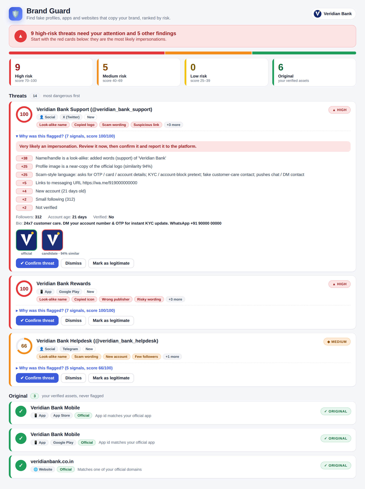
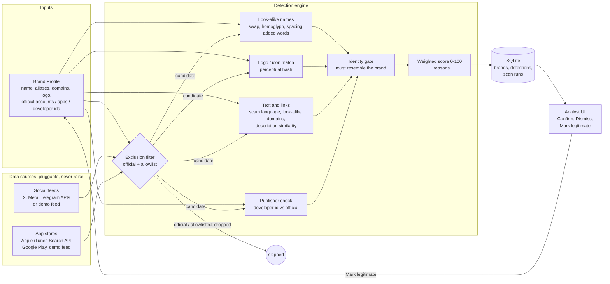

# 🛡️ Brand Guard: Digital Risk Protection for Social & App Monitoring

Define what is **legitimate** about a brand, then automatically find social profiles, pages and
mobile apps that **impersonate** it, ranked by risk, with a plain-English reason for every flag.

## Quick start

```bash
pip install -r requirements.txt
python scripts/make_demo_data.py      # (already included) regenerates the fictional demo brand + feeds
streamlit run app.py                  # web UI
python -m brandguard.cli scan         # same pipeline in the terminal
python -m pytest -q tests             # regression tests
python scripts/preview_ui.py --png    # static preview of the UI -> docs/ui_preview.png (no Streamlit needed)
```

In the UI: **➕ Create brand** (or **Load demo brand**) → **Run scan** (demo feeds work offline) → review the coloured cards on the **Dashboard**.
Switch the scan source to *Live: app stores + social media* to query the Apple App Store with the public iTunes Search API
(Google Play works if you `pip install google-play-scraper`).

## The UI at a glance



One colour language, used for nothing else (every card also has a text label and icon, so it works without colour vision):

| Colour | Meaning |
|---|---|
| 🟢 **Green** | **Original**: your own verified assets, or ones an analyst approved. Never flagged. |
| 🟡 **Yellow** | **Low risk** (score 25–39): weak signals, keep an eye on it |
| 🟠 **Orange** | **Medium risk** (40–69): suspicious, review soon |
| 🔴 **Red** | **High risk** (70–100): very likely an impersonation, act now |

* **Dashboard**: scan and review in one place. A banner answers "am I OK?" (coloured by the worst active threat),
  then risk tiles, filters (risk / type / status) and one card per finding with signal chips, a score ring and a
  *Why was this flagged?* panel (reasons with points, evidence, official-vs-candidate logo, mixed-alphabet warning).
  Actions: **Confirm threat**, **Dismiss**, **Mark as legitimate** (moves it to green), **Reopen**, **Remove approval**.
* **Brand profile**: a green "Protected as original" summary of everything that is never flagged, next to the live
  **Brand details checklist** (see below). **➕ Create brand** and **✏️ Edit brand** buttons (sidebar and this tab) open the editor
  in a pop-up; Edit also lets you rename a brand, and its scans and approvals follow the new name.
* **Look-alike lab**: type any name; the result is red (look-alike), yellow (weak) or green (not a look-alike).
* **Brand details checklist**: the details this project needs, ticked off live as you fill in the editor, with a completeness %.
  *Required*: brand name, official domains, official logo. *Recommended*: official social accounts, official apps, publisher
  (developer) id. *Optional*: aliases, keywords, official description. Each row says what is missing and what it powers.
  It uses blue only, so green / yellow / orange / red stay reserved for risk.
* Confirm / dismiss decisions survive re-scans. Theme lives in `.streamlit/config.toml` (primary colour is blue on purpose).

## Architecture



**How official assets are excluded**
1. *Before scoring*: an item is dropped if its platform + handle is in the profile's official accounts, its
   app id is an official app, or its store **developer id** is an official developer.
2. *Analyst allowlist*: "Mark as legitimate" appends the item to the profile, and it is never flagged again.
3. *Names are not trusted*: a publisher called "Veridian Bank Ltd" with the wrong developer id is
   **flagged as spoofing**, not excluded.

## Detection logic

| Signal | Social | App | Notes |
|---|---|---|---|
| Look-alike name | 45 pts | 40 pts | display name, handle, app name, package id |
| Logo / icon copy | 25 (near: 10) | 25 (near: 10) | dHash + aHash perceptual hash |
| Look-alike domain in links | 20 | – | e.g. `veridianbank-rewards.com` |
| Scam language | 25 | 10 | OTP / KYC / giveaway / fake care number / job scam |
| Publisher | – | 15–20 | not official; or copied name with wrong id |
| Description resemblance | – | 10 + 5 | similarity to official listing; names the brand |
| Boosters | 8 | 11 | new account, few followers, risky permissions, few installs |

Risk: **High ≥ 70 · Medium ≥ 40 · Low ≥ 25**. Below 25 is not reported.

**Identity gate**: nothing is reported unless it resembles the brand (look-alike name, logo copy,
look-alike domain, or brand mention combined with scam text / publisher mismatch). Boosters can never flag
anything on their own, so scammy-but-unrelated accounts and normal businesses are left alone.

### Look-alike name detection (bonus)
| Variation | Example (brand = "Veridian Bank") |
|---|---|
| Spacing change | `Veri dian Bank`, `VeridianBank` |
| Character swap / typo | `veridianbnak`, `Veridian Banks` |
| Look-alike glyphs | `Verldian Bank`, `Verid1an Bank` |
| Unicode homoglyph | `Vеridian Bank` (Cyrillic е) |
| Added words | `Veridian Bank Support`, `veridianbank_rewards` |
| Word order | `Bank Veridian` |

**Avoiding over-flagging**: weighted edit-distance budget (1 for short names, 2 for long); confusable
characters (`1/l/i`, `0/o`) cost less than random edits; generic added words only count against
*distinctive* names, so `Veridian Bakery`, `Veridian Credit Union` and `Venetian Bank` are not flagged;
commentary names (`… Fans`, `… News`) are down-weighted; third-party apps that merely mention the brand
(ATM finders) stay below threshold. All of this is covered by tests.

## Graceful handling of unavailable sources
Every connector goes through `safe_fetch()`: exceptions, missing credentials, missing optional packages
and timeouts become a readable **"unavailable"** status in the UI, and the scan continues with the
remaining sources.

## Project layout
```
app.py                    Streamlit UI (dashboard, brand profile, look-alike lab)
brandguard/ui.py          design system: CSS + HTML builders (pure functions, no Streamlit import)
brandguard/profile.py     brand profile, validation, live checklist, official-asset checks
brandguard/textmatch.py   look-alike name engine + variant generator
brandguard/logo.py        perceptual hashing
brandguard/detect.py      exclusion, scoring, explanations
brandguard/sources.py     connectors (demo, iTunes, Google Play, social API stub)
brandguard/storage.py     SQLite persistence and analyst status
brandguard/engine.py      scan orchestration (+ originals, rescan)   brandguard/cli.py   terminal runner
scripts/preview_ui.py     renders the dashboard to docs/ui_preview.html / .png without Streamlit
data/demo/                fictional brand, logos, social + app feeds
tests/test_detection.py   detection regression tests        tests/test_ui.py   UI helpers, escaping, originals, rescan
tests/test_checklist.py   live checklist, rename, create/edit buttons
```

## Look-alike domain discovery (no keys)
`brandguard/domain_sources.py` finds fake domains on its own: it generates look-alike names across ~18 endings and checks
DNS, searches Certificate Transparency logs (crt.sh) for domains containing the brand, then reads each live page for scam
wording and password/OTP forms. Scoring adds new-certificate age and abused endings. Misses: registered domains with no
web/DNS address record, and anything that is not guessed or in a certificate log. Registered look-alikes are *leads to review*,
not proof of fraud. Make sure your official domain list is complete or your own domains get flagged.

## Honest limitations
* The demo uses **fixture feeds** (fictional brand). The live Apple/Google connectors are included but
  depend on network access and unofficial or public endpoints, so check them in your own environment.
* **Live social coverage** (`brandguard/social_sources.py`): Bluesky, Mastodon and Reddit search work with no key;
  Telegram, TikTok and Facebook use *handle probing*; Instagram uses the official free Graph API *Business Discovery* when `IG_ACCOUNTS=ID:TOKEN,...` is set (Business/Creator accounts only), else probing (generate look-alike handles, check which exist);
  YouTube needs `YOUTUBE_API_KEYS=k1,k2,...` (or one `YOUTUBE_API_KEY`); X needs `X_BEARER_TOKENS=t1,t2,...` (paid tier). With several keys, a key that hits its quota is parked and the next one is used automatically. Instagram/Facebook/TikTok have no public
  search API and often block scripts, so they may show "unavailable". For reliable coverage use Meta Content Library
  or a data vendor. These connectors were tested with mocked HTTP only; verify live in your own environment.
* Logo matching is perceptual-hash based: strong for copies and recompression, weaker for heavily redrawn logos.
* Scores are transparent heuristics, not a trained model; weights are in `detect.py` and easy to tune.

## 3-minute demo script
1. **Profile**: load the demo brand; point out validation warnings and the official accounts / apps / developer id.
2. **Scan**: on the Dashboard press Run scan; the banner turns red. Open *Scan details* for the funnel and the unavailable Instagram API chip.
3. **Review**: open *Why was this flagged?* on `Veridian_Bank_Support` (name + logo + scam text), on `Veridian Bank - Official Pay` (spoofed publisher) and on the homoglyph `@veridianbank` (hidden Cyrillic letter).
4. **Mark as legitimate** one finding: it turns green under *Original*. Re-scan to show it stays excluded and your other decisions are kept.
5. **Look-alike lab**: type `Veridian Bakery` (clean) vs `veridianbnak` (flagged).
